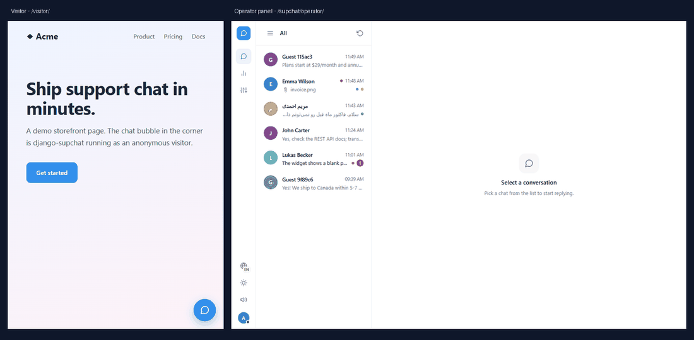
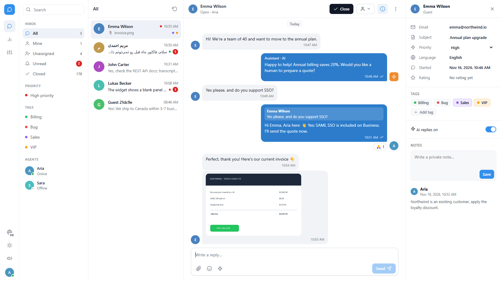
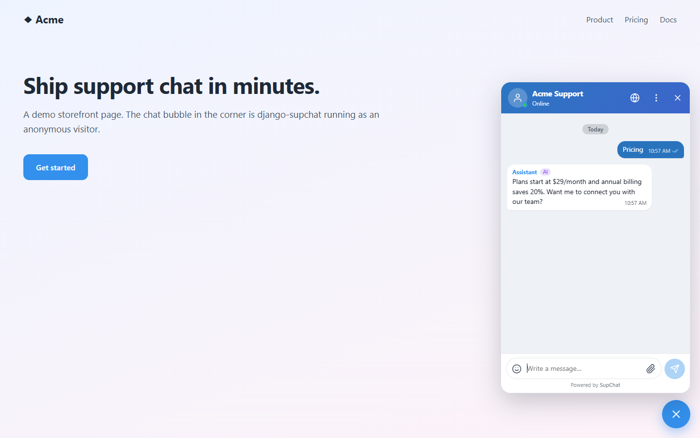
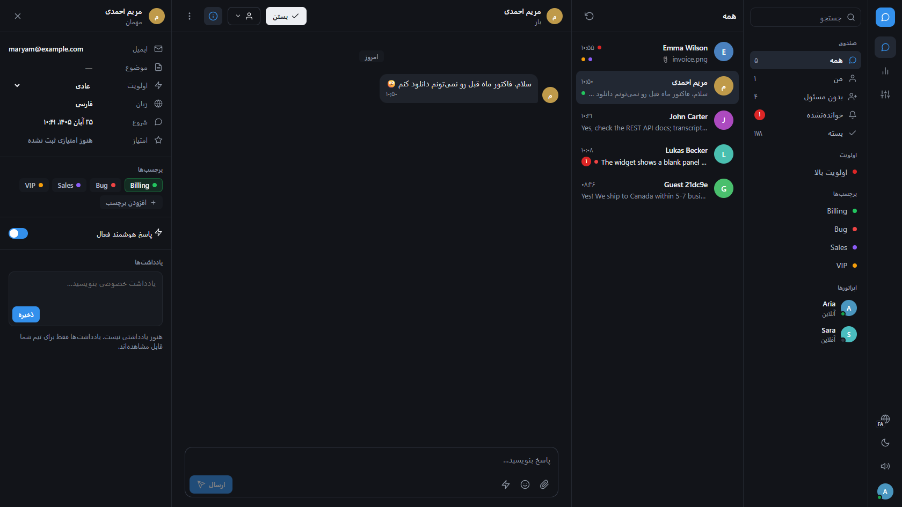
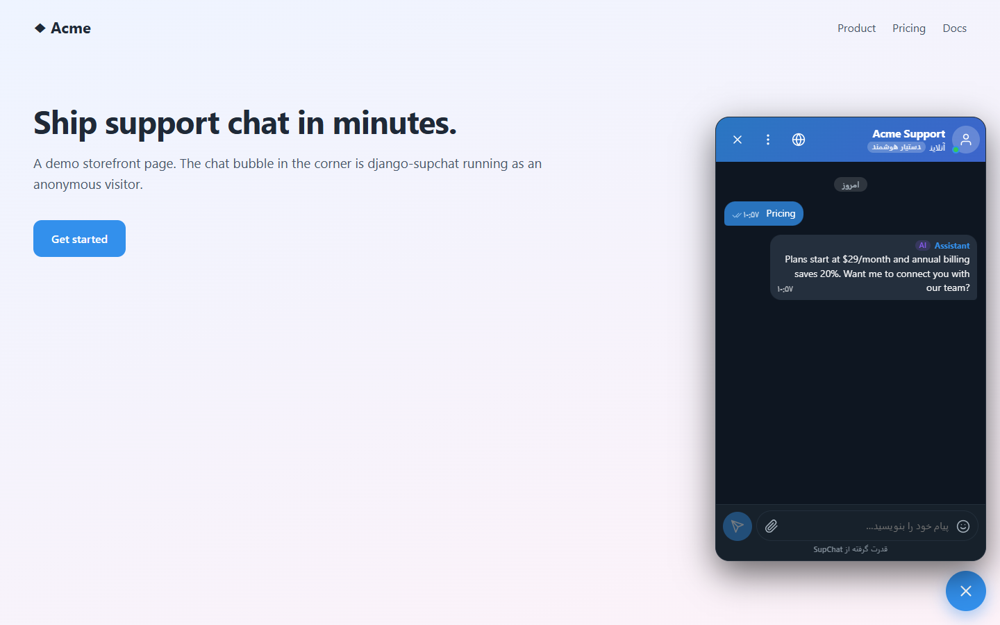
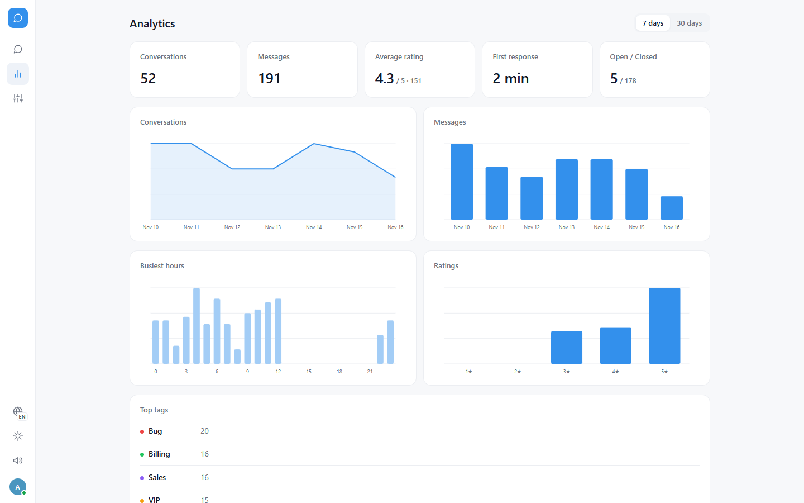
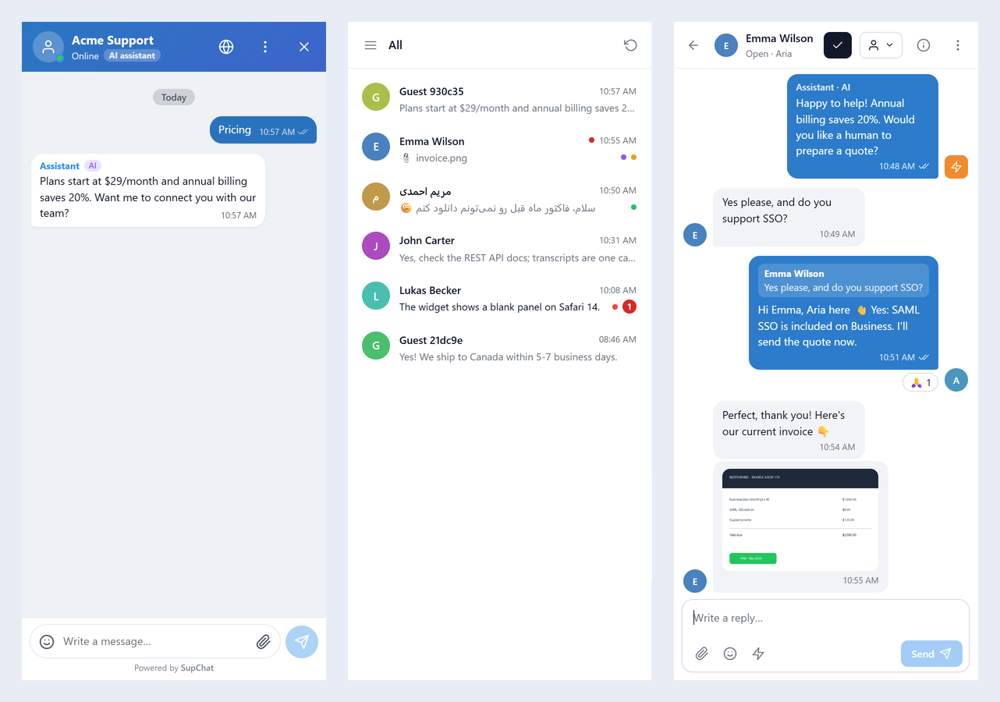

<div align="center">

# 💬 django-supchat

### Real-time support chat for Django: visitor widget, operator workspace, AI auto-replies

[](https://pypi.org/project/django-supchat/)
[](https://pypi.org/project/django-supchat/)
[](https://pypi.org/project/django-supchat/)
[](https://github.com/xo-aria/django-supchat/actions/workflows/tests.yml)
[](https://github.com/xo-aria/django-supchat/blob/main/LICENSE)
[](https://pepy.tech/project/django-supchat)

**Zero runtime dependencies. No Redis, no WebSockets required, no build step.**<br>
Django, vanilla JS and Server-Sent Events.

[Quick start](#-quick-start) · [Features](#-features) · [Documentation](https://github.com/xo-aria/django-supchat/tree/main/docs) · [راهنمای فارسی](https://github.com/xo-aria/django-supchat/blob/main/docs/fa.md)



</div>

---

## 🖼️ Preview

| Operator panel | Widget |
|---|---|
|  |  |
| **Persian, dark, right-to-left** | **Widget in Persian, dark** |
|  |  |

<details>
<summary><b>Analytics and mobile</b></summary>





</details>

---

## ✨ Features

**For visitors (the widget)**
- Real-time chat over SSE with typing indicators, read receipts (✓ / ✓✓) and an unread badge
- Replies, emoji reactions, emoji picker, image and file attachments (paste or pick), image lightbox
- Welcome message, quick-reply chips and an optional pre-chat form (name / email)
- End chat, 1–5 star rating with a comment, transcript download or email
- 8 languages (EN, FA, AR, TR, ES, DE, FR, RU) with a fixed language button and automatic RTL
- Light / dark / auto themes, an accent color and CSS variables
- Message sounds, synthesized with WebAudio (no audio files) and with a mute toggle
- Skeleton loading, full screen on phones, keyboard and screen-reader friendly, honours `prefers-reduced-motion`

**For operators (`/supchat/operator/`)**
- A calm five-pane workspace (rail, inbox, conversations, chat, details) with live updates
- Filters (all, unassigned, mine, unread, closed) and full-text search
- Assignment, priority, subject and colored tags
- Private internal notes that visitors never receive
- Quick replies: type `/shortcut` in the composer
- Attachments, replies, reactions, copy, and the visitor's typing state
- Close, reopen, block visitor, delete, and transcript download or email
- Analytics: conversations, messages, busiest hours, ratings, first-response time, top tags
- English/Persian (and 6 more) with a fixed language button, plus light/dark theme
- Desktop notifications, sound and keyboard shortcuts (`Ctrl/⌘ K`, `Alt ↑/↓`, `Esc`)

**AI and integrations**
- AI auto-replies from ChatGPT/OpenAI, Anthropic, or any OpenAI-compatible API (Groq, OpenRouter, Mistral, DeepSeek, Ollama, LM Studio, Azure…), or your own Python function
- Human handoff: the bot stops as soon as an operator replies or the visitor asks for a person
- Webhooks for Slack, Discord, or generic JSON signed with HMAC-SHA256
- REST + SSE API with header-token auth for mobile and native clients
- Optional WebSocket transport via Django Channels

**Security**
- CSRF on every cookie-authenticated POST
- Signed HttpOnly guest identity
- Access checks on every endpoint and stream
- Audience-scoped events, so notes never leak to visitors
- HTML stripping, a blocked-word list and rate limits
- Upload checks: an extension allowlist plus magic-byte sniffing, and SVG/HTML are always refused
- Attachments are served with `nosniff` and a sandbox CSP
- Webhook SSRF guard, visitor blocking by guest or hashed IP, and a retention clean-up command

---

## 🚀 Quick start

```bash
pip install django-supchat
```

```python
# settings.py
INSTALLED_APPS = [
    # ...
    "supchat",
]

SUPCHAT = {
    "TITLE": "Acme Support",
    "WELCOME_MESSAGE": "Hi! How can we help?",
}

# urls.py
from django.urls import include, path

urlpatterns = [
    # ...
    path("supchat/", include("supchat.urls")),
]
```

```bash
python manage.py migrate
```

```django

<!-- anywhere in your base template, usually right before </body> -->

```

Staff users open the operator panel at **`/supchat/operator/`**. That's it. 🎉

> Want AI replies? Add `"AI": {"ENABLED": True, "PROVIDER": "openai", "API_KEY": env("OPENAI_API_KEY"), "MODEL": "<model id>"}`. See [docs/ai.md](https://github.com/xo-aria/django-supchat/blob/main/docs/ai.md).

---

## 📚 Documentation

| Guide | What's inside |
|---|---|
| [Installation](https://github.com/xo-aria/django-supchat/blob/main/docs/installation.md) | Requirements, setup, media files, upgrading from 1.x |
| [Configuration](https://github.com/xo-aria/django-supchat/blob/main/docs/configuration.md) | Every `SUPCHAT` setting with defaults |
| [Widget](https://github.com/xo-aria/django-supchat/blob/main/docs/widget.md) | Template tag options, theming, CSS variables, JS API and events |
| [Operator panel](https://github.com/xo-aria/django-supchat/blob/main/docs/operator-panel.md) | Inbox, notes, quick replies, tags, analytics, shortcuts |
| [AI auto-replies](https://github.com/xo-aria/django-supchat/blob/main/docs/ai.md) | OpenAI/ChatGPT, Anthropic, OpenAI-compatible hosts, custom functions, handoff |
| [Webhooks](https://github.com/xo-aria/django-supchat/blob/main/docs/webhooks.md) | Slack, Discord, signed JSON and signature verification |
| [REST & mobile API](https://github.com/xo-aria/django-supchat/blob/main/docs/api.md) | Endpoints, SSE events, header-token auth for native apps |
| [Realtime & deployment](https://github.com/xo-aria/django-supchat/blob/main/docs/realtime.md) | SSE, proxies, multiple workers, the WebSocket adapter |
| [Security](https://github.com/xo-aria/django-supchat/blob/main/docs/security.md) | Threat model and every protection in place |
| [Languages](https://github.com/xo-aria/django-supchat/blob/main/docs/i18n.md) | Built-in languages, RTL, adding your own |
| [Python API & signals](https://github.com/xo-aria/django-supchat/blob/main/docs/python-api.md) | Service functions, signals, management command |
| [Development](https://github.com/xo-aria/django-supchat/blob/main/docs/development.md) | Running tests, the demo project, contributing |
| [راهنمای فارسی](https://github.com/xo-aria/django-supchat/blob/main/docs/fa.md) | خلاصه‌ی نصب و امکانات به فارسی |

---

## 🗺️ Roadmap

- [x] File and image attachments
- [x] Message reactions and emoji
- [x] Conversation tags and priority
- [x] Canned responses / quick replies
- [x] Chat transcripts by email and download
- [x] Webhook integrations (Slack, Discord, signed JSON)
- [x] AI auto-responses (OpenAI-compatible, Anthropic, custom)
- [x] Multi-language support beyond EN/FA (8 languages)
- [x] REST/SSE API with token auth for mobile clients
- [x] Optional WebSocket adapter (Django Channels)
- [ ] Native iOS / Android SDK packages (the API is ready; see [docs/api.md](https://github.com/xo-aria/django-supchat/blob/main/docs/api.md))
- [ ] Business hours and offline forms
- [ ] Message search inside a conversation

---

## 🤝 Contributing

```bash
git clone https://github.com/xo-aria/django-supchat.git
cd django-supchat
pip install -e ".[test]"
pytest --cov=supchat
```

See [docs/development.md](https://github.com/xo-aria/django-supchat/blob/main/docs/development.md) for the demo project and guidelines.

---

## 📄 License & Trademark

**django-supchat** is licensed under the **GNU Affero General Public License v3.0 (AGPL-3.0)**. You may use, modify and distribute it, commercially too. If you distribute it or run a modified version as a network service, you must publish your source under the same license and state your changes. 📖 [Full license](https://github.com/xo-aria/django-supchat/blob/main/LICENSE)

The name **"SupChat"** is a trademark of xo-aria. See the [Trademark Policy](https://github.com/xo-aria/django-supchat/blob/main/TRADEMARK.md). When you distribute it, keep the attribution:

```markdown
Based on SupChat by xo-aria
https://github.com/xo-aria/django-supchat
Licensed under AGPL-3.0
```

Need a commercial license without the AGPL terms? Open an issue or [contact us](mailto:your-email@example.com).

---

<div align="center">

**If django-supchat helps your project, please ⭐ the repository.**

[Issues](https://github.com/xo-aria/django-supchat/issues) · [Discussions](https://github.com/xo-aria/django-supchat/discussions) · Made with ❤️ by [xo-aria](https://github.com/xo-aria)

</div>
