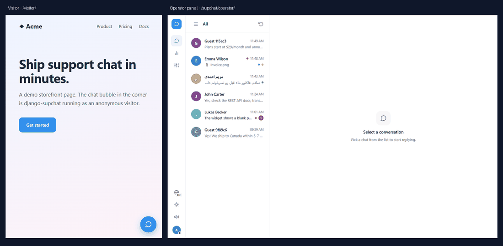

<div dir="rtl">

# راهنمای فارسی django-supchat

**django-supchat** یک چت پشتیبانی لحظه‌ای برای جنگو است. شامل ویجت بازدیدکننده، پنل اپراتور مدرن و پاسخ خودکار هوش مصنوعی است. هیچ وابستگی جانبی ندارد: بدون Redis و بدون WebSocket اجباری، فقط جنگو و Server-Sent Events.



## نصب سریع

</div>

```bash
pip install django-supchat
```

```python
# settings.py
INSTALLED_APPS += ["supchat"]
SUPCHAT = {"TITLE": "پشتیبانی", "LANGUAGE": "fa"}

# urls.py
path("supchat/", include("supchat.urls")),
```

```bash
python manage.py migrate
```

```django


```

<div dir="rtl">

پنل اپراتور برای کاربران staff در آدرس `/supchat/operator/` در دسترس است.

## امکانات

- **ویجت:**
  - پیام لحظه‌ای، نشانگر «در حال نوشتن» و تیک خوانده‌شدن
  - پاسخ به پیام، واکنش ایموجی، ارسال عکس و فایل
  - پیام خوش‌آمد، دکمه‌های پاسخ سریع و فرم پیش از گفتگو
  - امتیازدهی ۱ تا ۵، و دانلود یا ارسال متن گفتگو به ایمیل
  - صدای پیام، تم روشن/تیره و دکمه‌ی ثابت تغییر زبان
  - تمام‌صفحه روی موبایل
- **پنل اپراتور:**
  - فضای کاری پنج‌بخشی (نوار ابزار، صندوق، گفتگوها، چت، جزئیات) با فیلترها و جستجو
  - تخصیص، اولویت و برچسب رنگی
  - **یادداشت داخلی** که بازدیدکننده هرگز نمی‌بیند
  - پاسخ‌های آماده با `/`، مسدودسازی بازدیدکننده
  - آمار و نمودار، اعلان دسکتاپ و میانبرهای صفحه‌کلید
- **هوش مصنوعی:**
  - اتصال به ChatGPT/OpenAI، Anthropic و هر API سازگار با OpenAI (Groq، OpenRouter، Ollama و…)
  - امکان استفاده از تابع پایتونی خودتان
  - با پاسخ اپراتور یا درخواست «اپراتور» از طرف کاربر، کار به انسان سپرده می‌شود.
- **یکپارچه‌سازی:**
  - وب‌هوک Slack، Discord و JSON امضاشده
  - API و SSE برای اپ موبایل با توکن هدر
  - آداپتور WebSocket اختیاری
- **امنیت:**
  - CSRF و کوکی امضاشده
  - جداسازی رویدادهای داخلی
  - بررسی محتوای فایل‌ها و محدودیت نرخ
  - محافظت SSRF و دستور پاک‌سازی داده‌های قدیمی

## زبان‌ها

انگلیسی و فارسی به‌طور کامل نگهداری می‌شوند. عربی، ترکی، اسپانیایی، آلمانی، فرانسوی و روسی هم موجودند ولی ترجمه‌شان هنوز بازبینی نشده است. چیدمان راست‌به‌چپ و تقویم شمسی خودکار اعمال می‌شود.

## هوش مصنوعی (نمونه)

</div>

```python
import os
SUPCHAT = {
    "AI": {
        "ENABLED": True,
        "PROVIDER": "openai",          # یا "anthropic" یا "custom"
        "API_KEY": os.environ["OPENAI_API_KEY"],
        "MODEL": "<نام مدل>",
        "SYSTEM_PROMPT": "تو دستیار پشتیبانی فروشگاه ما هستی. کوتاه و مؤدب پاسخ بده.",
    },
}
```

<div dir="rtl">

مستندات کامل (به انگلیسی) در [پوشه‌ی docs](README.md) است.

</div>
