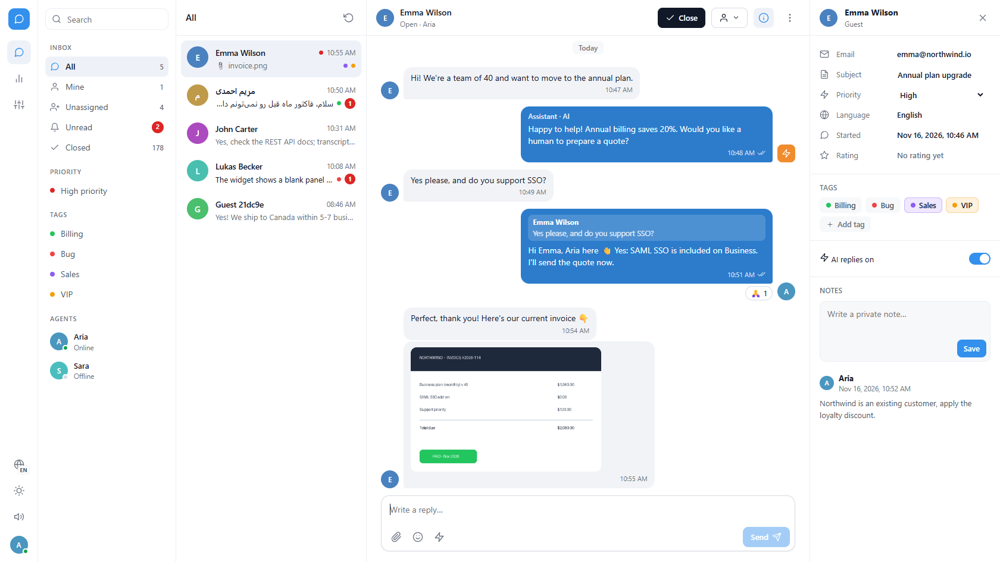

# The operator panel

Open **`/supchat/operator/`** as a staff user. The panel is one page that talks to a JSON API and a single SSE stream (`/supchat/operator/api/stream/`).

## Layout

| Pane | Contents |
|---|---|
| **Rail** | Chats, Analytics and Settings, plus fixed buttons for language (it shows the current code, e.g. `EN`/`FA`), theme and sound. Your avatar sits at the bottom. |
| **Inbox** | Search. Inbox views (All, Mine, Unassigned, Unread, Closed) with live counters, a High priority filter, tag filters and the agents list with online status. |
| **Conversations** | Rows with unread badge, priority dot, tag dots and "typing…". Active filters appear as removable chips. |
| **Chat** | Name and status, a **Close** or **Reopen** button, the assignee picker, the details toggle and the ⋮ menu. Below them: the messages and the composer. |
| **Details** | Email, subject, priority, language, start time and rating, then tags, the AI switch and **private notes**. |

Layout by screen width:
- **Above 1440px:** all five panes fit.
- **Up to 1440px:** details open as an overlay.
- **Up to 1180px:** the inbox becomes a drawer (☰).
- **Up to 760px:** one pane at a time, with a back button. The rail moves into the drawer.

Switching theme or language never rebuilds or re-animates the page.

## Inbox

- **Views:** All open, Mine, Unassigned, Unread, Closed. Combine them with **High priority** and a **tag** filter.
- **Search** covers names, emails, subjects, usernames and message text.
- Conversations appear (with a sound) on the visitor's first message. Opening the widget alone creates nothing in the inbox.
- Live updates: new conversations play a sound and show a toast. A desktop notification also appears when the tab is hidden and notifications are enabled in Settings.

## Messages

- Visitor messages are grey, team messages are blue, and consecutive messages are grouped.
- AI messages carry an orange bot avatar and an "AI" label.
- There are no decorative borders or bouncing animations. New messages fade in.

## Composer

| Action | How |
|---|---|
| Send | `Enter` (`Shift+Enter` for a new line; IME-safe) |
| Quick reply | Type `/` (or press ⚡) and the shortcut, e.g. `/refund`, then `Enter` or `Tab` |
| Attach | 📎 or paste an image |
| Emoji | 😊 button |
| Reply | Hover a message → ↩ |
| React / copy | Hover a message → 😊 / ⧉ |

Typing sends a throttled "typing" signal to the visitor.

## Private notes

Write notes in the **Notes** box of the details pane (`Ctrl/⌘ + Enter` saves). Notes stay out of the conversation stream. Visitors never receive them, and they appear only in the panel and in transcripts downloaded with notes.

## Actions (⋮ menu)

Close or reopen, assign to me, download the transcript (with notes), email the transcript, block the visitor, and delete (asks for confirmation; files are removed too).

Blocking a guest stores the guest id and a salted hash of the IP; blocking a logged-in user stores the account. It closes the conversation, and that visitor can no longer start or send. Undo it in **Settings → Blocked visitors**.

## Settings page

- Language, theme, sound, desktop notifications
- **Quick replies**: add/remove `/shortcut` → text
- **Tags**: name + color
- **AI auto-reply** status (configured in `settings.py`)
- **Webhooks** (superusers): status of each endpoint and a **Test** button
- **Blocked visitors** with Unblock

## Analytics

Choose 7 or 30 days:

- Conversations per day (line chart) and messages per day (bars)
- Busiest hours, rating distribution, average rating
- Average first-response time
- Open and closed totals, top tags

The charts are inline SVG, with no third-party scripts.

## Keyboard shortcuts

| Keys | Action |
|---|---|
| `Ctrl/⌘ + K` | Focus search |
| `Ctrl/⌘ + Enter` | Save a private note |
| `Alt + ↓ / ↑` | Next / previous conversation |
| `Esc` | Close menus and popups, cancel the reply |

## Deep links

`/supchat/operator/#c=<conversation-uuid>` opens a conversation directly. This is useful in webhook messages.

## Permissions

Staff users and users with an `Operator` profile can use the panel. The JSON API answers `401` to anonymous users and `403` to non-staff users. Webhook management is limited to superusers.
